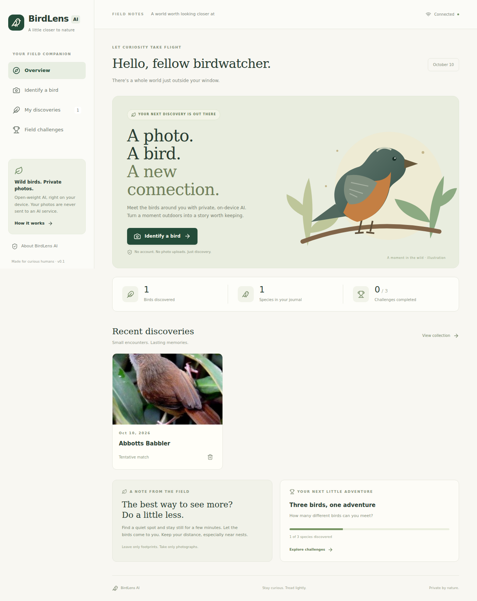
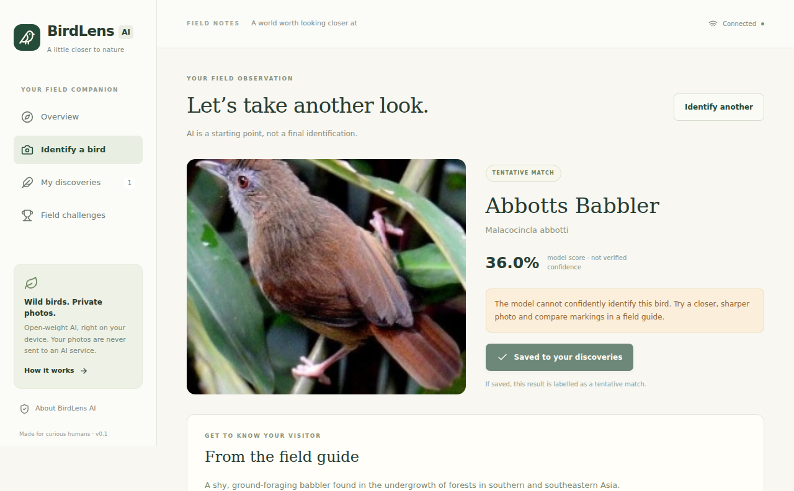
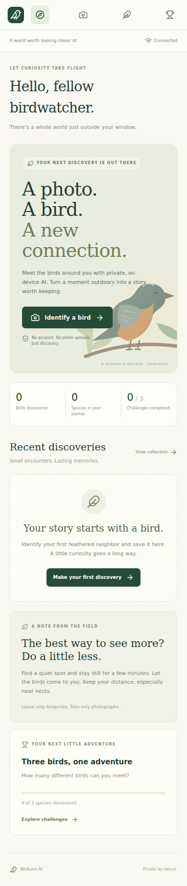

# BirdLens AI

A private, nature-inspired bird identification companion. Upload a real bird photograph, run an open-weight classifier locally, consult a sourced species reference, and keep discoveries in an offline journal.

## Quick start

Requires Node.js **22.12+ or 24 LTS**, npm, and a modern browser with WebAssembly, workers, OffscreenCanvas, IndexedDB, and Cache Storage.

```sh
npm ci
npm run model:download
npm run dev
```

Open the local URL printed by Vite. In this WSL environment Node is installed at `/home/windows/.local/node-birdlens/bin`; prepend that directory to `PATH` if necessary:

```sh
export PATH=/home/windows/.local/node-birdlens/bin:$PATH
```

No API keys, accounts, or paid services are required. Photographs never leave the device for inference. The camera button uses the browser's file capture capability; on desktop it may open a file chooser instead. JPEG, PNG, and WebP under 15 MB are supported; convert HEIC first.

### Production and local demo

```sh
npm run build
npm run preview
```

For deployment, serve **all of `dist/`**, including `models/birds.onnx`, from an HTTPS origin at the root path. Localhost is also a secure context. Service workers are registered only in production; `npm run dev` does not provide an offline shell. On a phone, ordinary HTTP over a LAN address may not support secure-context features. Use HTTPS for a real mobile demo.

## Features

- Forest-green, warm-cream responsive dashboard with original local SVG artwork.
- Genuine on-device inference with top-five model outputs, honest scores, loading/error states, and tentative-match handling.
- Seven bundled, sourced field-guide entries (six Cornell references and one Wikipedia reference) with habitat, distribution, diet, identification features, and a fact. Other unambiguous labels use Wikipedia summaries with source links when available. Missing details are not fabricated.
- IndexedDB journal storing the original photo, model candidates, timestamp, and reference snapshot; species search, date filtering, deletion.
- Three challenges: automatic three-species tracking and two reversible self-reported activities.
- Production app-shell/runtime caching and model caching for offline revisits and identification after initial setup.
- No telemetry, account, backend, or remote image processing.

## Model details and license

| Item | Integration |
| --- | --- |
| Model | [chriamue/bird-species-classifier](https://huggingface.co/chriamue/bird-species-classifier), EfficientNet-B2 |
| Revision | `c8b211833491b1032250462c2b7e53e02f4de336` |
| Export | `onnx/model.onnx`, approximately 32.2 MiB, float32 |
| SHA-256 | `09b950b371030de9003824baa66457f2e8fc4f96fe87a34cc4c3b242b2864d8b` |
| Supported outputs | 525 dataset classes; exact ordered labels in `src/data/labels.json` |
| License | MIT, **as declared by the publisher's model card** |
| Training dataset | [chriamue/bird-species-dataset](https://huggingface.co/datasets/chriamue/bird-species-dataset), declared CC0-1.0, sourced from Kaggle |
| Runtime | ONNX Runtime Web 1.24.2, single-threaded WebAssembly in a worker |
| Input | RGB, NCHW float32, `[1,3,260,260]` |
| Preprocessing | Direct nearest-neighbor resize to 260×260; divide by 255; mean `[0.485,0.456,0.406]`; standard deviation `[0.47853944,0.4732864,0.47434163]`; second division by std to match the published EfficientNet `include_top=true` processor |
| Output processing | Stable softmax over logits; top-five ranked labels |

The download script pins the revision and verifies the checksum before writing `public/models/birds.onnx`. Model weights are ignored by Git. Download once before building. Runtime verifies the first uncached model load too.

The original model was selected instead of the `ozzyonfire` ResNet fork because that fork's ResNet training code, EfficientNet config, and preprocessing metadata do not agree. This application does not rely on those inconsistent artifacts.

Publisher metadata is evidence of the stated license, not a legal audit of every training photograph. Review dataset provenance before commercial redistribution. The application code is MIT; Wikipedia text remains CC BY-SA 4.0 and includes attribution/source links. Cornell-based entries are original concise paraphrases with references, not copied account text. Local artwork is part of the MIT application.

## Accuracy and limitations

The publisher reports **96.8% validation accuracy** on 2,625 dataset validation images. This is **not independently verified field accuracy**, not a guarantee for this ONNX export, and not a calibration result. Browser integration checks are not an accuracy benchmark. No full independent accuracy or device-performance benchmark is claimed.

- This is a closed-set classifier, not a bird detector. Non-birds and unsupported species can produce high scores.
- Dataset labels include broad categories and spelling errors; not all 525 labels correspond cleanly to a species.
- Similar species, juveniles, unusual poses, small subjects, poor light, and multiple birds can confuse the model.
- Scores are model probabilities, not calibrated identification confidence. The app uses a heuristic threshold of 0.70 and a top-two margin of 0.20 for tentative results. Even above those thresholds, results remain suggestions.
- Nearest-neighbor browser resizing can differ slightly from Pillow's pixel-coordinate behavior. Validate any future preprocessing change against a trusted Python reference.
- Uploads are restricted to 15 MB, but decoding very large pixel dimensions can still exhaust memory. No universal RAM/latency guarantee is made; test target devices.
- Scientifically important records should be independently verified. Do not use this app to approach, disturb, or target birds.

## Offline behavior, precisely

| Feature | Offline requirements |
| --- | --- |
| Interface | One successful production service-worker installation; all built UI/worker/WASM assets cached |
| Saved photos and challenges | IndexedDB retained in the same browser/origin |
| Saved species reference | Reference snapshot saved with the discovery |
| Bundled field guide | Included in cached UI; seven entries available |
| Identification | Model downloaded and cached during a previous identification; working WASM/worker APIs and sufficient memory |
| New Wikipedia references | Internet required unless that label's summary was previously cached |

The UI's “model saved” message checks the model cache only; it does not guarantee the app-shell cache is installed. The production shell caches roughly 12 MB of WASM plus JS/CSS, in addition to the 32 MB model. First visits therefore need an internet connection or access to the local server. Browser storage eviction, private mode, or clearing site data may remove caches and discoveries. No cross-device synchronization or export/import is implemented.

## Architecture

```text
src/App.tsx                      Dashboard, hash routes, result and journal UI
src/components/ui/button.tsx     shadcn-style Radix Slot/Tailwind button
src/lib/inference.ts             UI-to-worker bridge, timeout, cache status
src/lib/inference.worker.ts      Local image preparation and ONNX session
src/lib/predictions.ts           Stable score calculation and uncertainty rules
src/lib/birds.ts                 Bundled guide / Wikipedia reference resolution
src/lib/storage.ts               Typed IndexedDB stores
src/data/                       Ordered model labels and sourced field guide
public/sw.js                    Production shell caching
scripts/download-model.mjs       Pinned, integrity-checked model setup
```

Frontend: React, TypeScript, Vite, Tailwind CSS v4, a shadcn-style Radix button, and Lucide icons. Inference is isolated in a module worker and does not block the React render loop. Photos are stored as IndexedDB Blobs and rendered with revocable object URLs. There is no server component.

## Verification

```sh
npm test
npm run build
npm audit
npx playwright install chromium --only-shell
npm run test:e2e
```

Unit tests exercise softmax ranking, invalid output rejection, uncertainty rules, sourced/offline information handling, actual Blob persistence/removal, and challenge persistence. Browser tests exercise mobile layout and persistence. The real-model browser test uses the attributed fixture in `tests/fixtures/abbotts-babbler.jpg`. It checks real inference, saving, offline reload, a second offline inference, and removal. This image is only a smoke test from the model's source dataset, not an independent benchmark.

The browser test generates `screenshots/dashboard.png` after successful inference. Generate screenshots from the real app rather than substituting mock prediction screens.

### Screenshots





### Verification performed in this workspace

Eight unit tests and two Chromium browser tests passed, the production build passed, and `npm audit` reported zero vulnerabilities. The real ONNX model ranked the dataset Abbott's babbler fixture first with a **36.0%** score. The UI correctly treated it as tentative. The same real inference worked after a network-disabled production reload. This is one integration smoke test, not evidence of 96.8% field accuracy.

For this minimal WSL environment, Chromium's missing shared libraries were downloaded and extracted under the user's home directory (no privileged system installation). To rerun browser tests here:

```sh
export LD_LIBRARY_PATH=/home/windows/.local/birdlens-browser-libs/usr/lib/x86_64-linux-gnu
npm run test:e2e
```

## Demo walkthrough

1. Download the model, build, and launch the production preview.
2. Open **Identify a bird** and select a clear real bird photograph.
3. Wait for genuine worker inference; inspect the model score, alternate candidates, and reference. An unclear result is displayed as tentative.
4. Save it, open **My discoveries**, and test species/date filtering.
5. Complete an observation challenge and reload to confirm persistence.
6. After service-worker/model caching finishes, disable the network and reopen the journal. Try identifying another photo offline.

An actual browser screen recording is available locally at [demo/birdlens-demo.webm](demo/birdlens-demo.webm), showing real identification, the tentative result, and saving/opening the journal. No hosted demo has been published automatically.

## Why open-weight local AI?

Compared with a closed remote API, a redistributable model allows users to inspect labels and preprocessing, pin a reproducible revision, run without credentials or per-request fees, avoid sending nature photographs to a third party, and identify offline after downloading. Contributors can evaluate and replace the model without changing the UI. These are concrete capabilities, not a claim that this model is more accurate than every closed service.

## Publishing and Hacktoberfest

This directory is the local source project. A public repository and hosted demo still require your hosting account and destination; neither is falsely claimed to exist. Create a public repository, push the intended source files without model weights/node_modules, and deploy `dist/` after downloading the model. Review licensing and model-hosting limits before publishing.

See [CONTRIBUTING.md](CONTRIBUTING.md) for focused contribution ideas. Choose Hacktoberfest topics and issue labels according to the current program rules; public hosting alone does not guarantee eligibility.
